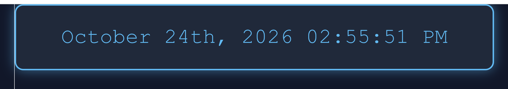

# Dynamic Color Clock

A React app built with Vite that displays the current date and time, updating every second. Date formatting is handled by `date-fns`.

## Prerequisites
- Node.js (v18 or newer) and npm

## Run locally
1. Clone the repo:
   git clone https://github.com/ericadrinksmatcha/color-clock.git
2. Move into the project folder:
   cd color-clock
3. Install dependencies:
   npm install
4. Start the dev server:
   npm run dev
5. Open the URL printed in the terminal (usually http://localhost:5173).

## Project structure
- `src/main.jsx`: entry point that renders `App` into the page
- `src/App.jsx`: the clock component (state, timer, date formatting)
- `src/Clock.css`: clock styling
- `package.json`: dependencies, including `date-fns@2.30.0`

## Screenshot
